# Codyssey Mission 2 - Python Quiz Game

## 1. 프로젝트 개요
Python을 사용하여 터미널에서 실행하는 퀴즈 게임을 제작한다.


## 2. 퀴즈 주제
Python 기초 퀴즈

선정 이유: Python의 변수, 자료형, 조건문, 반복문, 함수 등
기초 문법을 복습하고, 직접 퀴즈 프로그램을 구현하면서
프로그래밍 원리를 이해하기 위해 선정하였다.


## 3. 개발 환경
- Python 3.11.6
- Git 2.56.0
- VS Code
- Windows / PowerShell

### 환경 확인


## 4. 실행 방법
python main.py


## 5. 주요 기능

- [x] 메뉴 출력 및 선택
- [x] 종료 기능
- [x] 퀴즈 풀기
- [x] 퀴즈 추가
- [x] 퀴즈 목록
- [x] 최고 점수 확인
- [x] JSON 파일 저장 및 불러오기
- [x] 기본 입력 오류 처리


## 6. 파일 구조

```text
codyssey-2/
├── images/
├── .gitignore
├── main.py
├── README.md
└── state.json
```


## 7. 데이터 저장
- 파일명: `state.json`
- 인코딩: UTF-8
- `quizzes`: 문제, 선택지, 정답을 저장
- `best_score`: 최고 점수를 저장


## 8. 실행 결과
### 1. 메뉴 화면
python main.py 실행 시 메뉴 출력 및 번호 선택 기능 구현 완료.


### 2. 퀴즈 풀기
Python 기초 문법에 관한 기본 퀴즈 5개를 출제하고,
사용자가 입력한 답의 정답 여부를 확인하도록 구현하였다.

정답은 1점, 오답은 0점으로 처리하며,
모든 문제를 완료하면 최종 점수를 출력하고 메인 메뉴로 돌아간다.

 

### 3. 퀴즈 추가

사용자가 문제와 선택지 4개, 정답 번호를 입력하여
새로운 퀴즈를 추가할 수 있도록 구현하였다.

추가한 퀴즈는 state.json에 저장되며, 프로그램을 종료하고 다시 실행해도 유지된다.

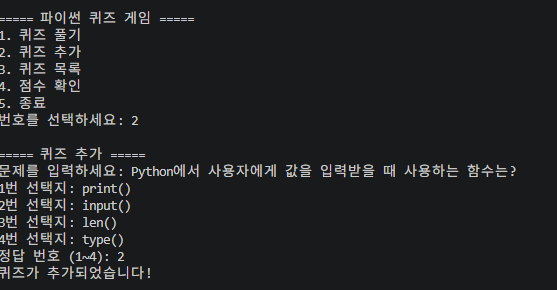
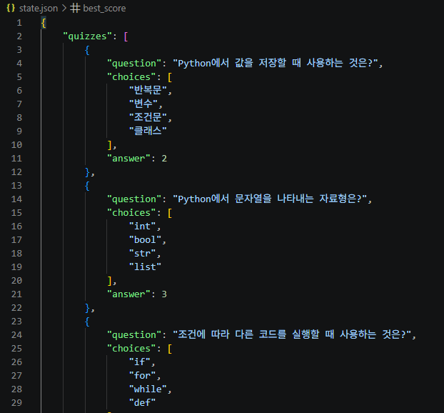


### 4. 퀴즈 목록

현재 등록된 퀴즈의 문제를 번호와 함께 출력하고,
전체 퀴즈 개수를 확인할 수 있도록 구현하였다.

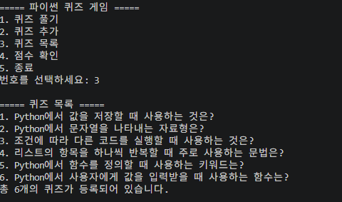

### 5. 최고 점수 확인

퀴즈를 완료하면 최고 점수를 갱신하고,
프로그램을 재실행해도 최고 점수가 유지되도록 구현하였다.

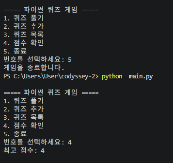

### 6. 입력 오류 및 예외 처리

잘못된 숫자, 문자, 빈 입력이 발생하면
안내 메시지를 출력하고 다시 입력받도록 구현하였다.

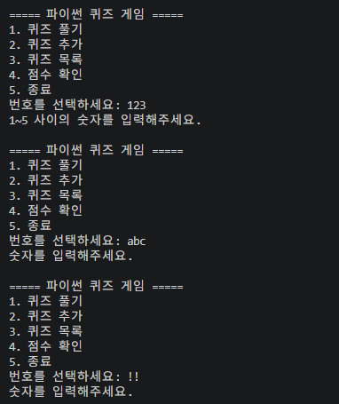
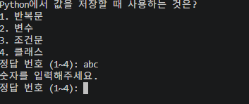

Ctrl+C 및 EOFError 발생 시 예외를 처리하고,
state.json 파일의 이름을 임시로 state1.json으로 변경하여 저장 파일이 없는 상황을 재현하고, 기본 퀴즈로 실행되는지 확인하였다.

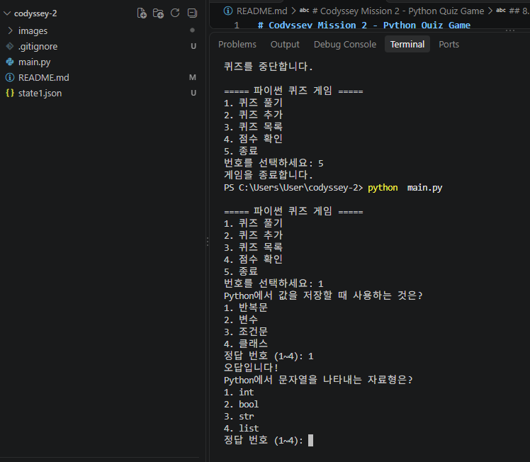


## 9. Git 작업 기록
기능별 커밋, 브랜치 생성 및 병합, clone과 pull 실습을 진행한다.

 ### 1. Git 브랜치 생성 및 확인

 퀴즈 풀기 기능을 개발하기 위해
 `feature/quiz-play` 브랜치를 생성하였다.
 `git branch` 명령어로 현재 작업 브랜치를 확인하였다.

 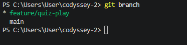

 퀴즈 게임의 기능 구현과 테스트를 완료한 후
`git checkout main` 명령어로 main 브랜치로 이동하였다.
이후 `git merge feature/quiz-play` 명령어를 실행하여
개발 브랜치의 작업 내용을 main 브랜치에 병합하였다.

병합 결과 `Fast-forward` 메시지가 출력되었으며,충돌 없이 변경 사항이 반영된 것을 확인하였다.
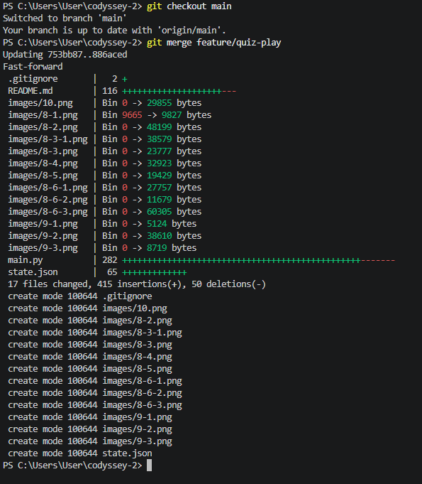

 ### 2. Git 커밋 및 변경 이력 확인
 프로젝트 개발 과정에서 기능별 변경 사항을 커밋으로 기록하였다.
 git --no-pager log --oneline --graph --all

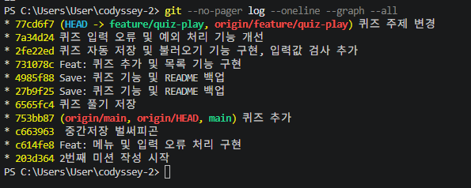

 ### 3. Git clone 및 pull 실습
GitHub 저장소를 `git clone` 명령어로 코디세이 컴퓨터에 복제하여 작업 환경을 구성하였다.
`git pull origin feature/quiz-play` 명령어를 실행하여 원격 저장소와 현재 브랜치의 동기화 상태를 확인하였다.

실행 결과 `Already up to date.` 메시지가 출력되어 최신 상태임을 확인하였다.

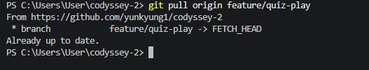


## 10. 보너스 기능 - 퀴즈 무작위 출제
퀴즈를 실행할 때마다 문제의 출제 순서가 무작위로 변경되도록 기능을 추가하였다.

기존에는 등록된 순서대로 문제가 출제되었지만, 무작위 출제 기능을 통해 반복 실행 시 다양한 순서로 문제를 풀 수 있도록 개선하였다.
import random
 for quiz in random.sample(self.quizzes, len(self.quizzes)):

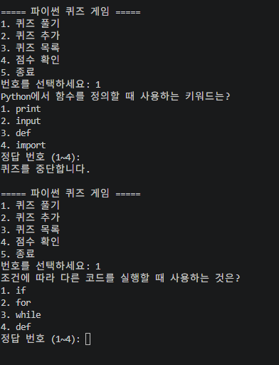