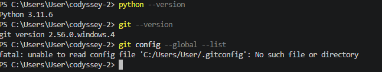
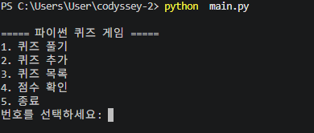
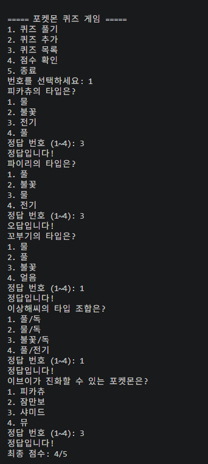

# Codyssey Mission 2 - Python Quiz Game

## 1. 프로젝트 개요
Python을 사용하여 터미널에서 실행하는 퀴즈 게임을 제작한다.

## 2. 퀴즈 주제
포켓몬 퀴즈

선정 이유: 평소 관심 있는 주제로 직접 문제를 만들고 Python 프로그래밍을 학습하기 위해 선택하였다.

## 3. 개발 환경
- Python 3.11.6
- Git 2.56.0
- VS Code
- Windows / PowerShell

### 환경 확인


## 4. 실행 방법
python main.py


## 5. 주요 기능
- [x] 메뉴 출력 및 선택
- [x] 종료 기능
- [x] 기본 입력 오류 처리
- [ ] 퀴즈 풀기
- [ ] 퀴즈 추가
- [ ] 퀴즈 목록
- [ ] 최고 점수 확인
- [ ] JSON 파일 저장 및 불러오기

## 6. 파일 구조
```text
codyssey-2/
├── main.py
├── state.json
├── README.md
├── .gitignore
└── images/
    └── 1.png
```

## 7. 데이터 저장
- 파일명: `state.json`
- 저장 위치: 프로젝트 최상위 폴더
- 인코딩: UTF-8
- `quizzes`: 문제, 선택지, 정답을 저장
- `best_score`: 최고 점수를 저장

## 8. 실행 결과
 ### 1. 메뉴 화면
 python main.py 실행 시 메뉴 출력 및 번호 선택 기능 구현 완료.
 

 ### 2. 퀴즈 풀기

포켓몬 기본 퀴즈 5개를 순서대로 출력하고,
사용자가 입력한 답의 정답 여부를 확인하도록 구현하였다.

정답은 1점, 오답은 0점으로 처리하며,
모든 문제를 완료하면 최종 점수를 출력하고 메인 메뉴로 돌아간다.


## 9. Git 작업 기록
기능별 커밋, 브랜치 생성 및 병합, clone과 pull 실습을 진행한다.